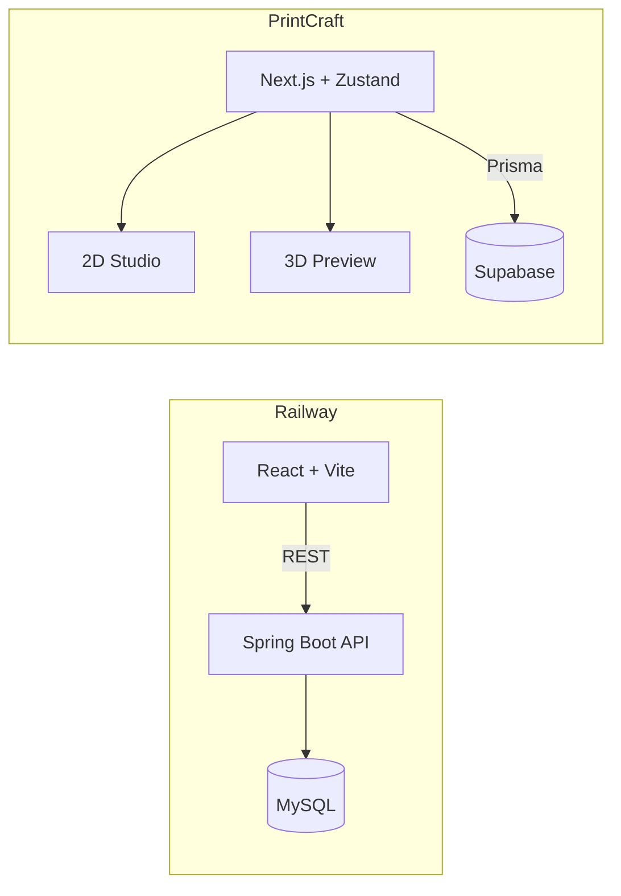

<div align="center">

# Ilmaan Khan

**Full-stack developer who builds complete apps, from database schema to UI.**

B.Tech Information Science at CMRIT, Bengaluru · Class of 2028


[](https://www.linkedin.com/in/ilmaan-khan/)
[](mailto:ilm2ankhan@gmail.com)

</div>

---

## About

I learn by building whole applications: designing the data model, writing the API, then making it usable in the browser. My recent work is a Spring Boot + React system that predicts railway station congestion, and a Next.js platform for a Bengaluru printing business with a 2D design editor and 3D packaging preview.

I like databases, clean APIs, and problems where the interface has to do something non-trivial.

## Tech stack

| | |
|---|---|
| **Languages** |     |
| **Frontend** |      |
| **Backend and data** |     |
| **Tools** |     |

---

## Featured projects

[](https://github.com/ilm2ankhan-maker/Railway_congestion)
[](https://github.com/ilm2ankhan-maker/printcraft-vajra-prints)

### Railway Congestion Prediction System

Search a PNR and see whether the station will be Low, Medium, or High congestion.

- Congestion prediction from reservation data
- REST API between a React (Vite) frontend and Spring Boot backend
- MySQL for data management

`Java` `Spring Boot` `React` `Vite` `MySQL`

### PrintCraft: Digital Prepress and E-Commerce

Built for Vajra Prints, a commercial printing business in Bengaluru, as a team project at CMRIT.

- 2D design studio with bleed lines, templates, and SVG/PNG layers
- 3D packaging customizer with real-time preview
- Laser-cutting price calculator driven by SVG outlines
- Staff dashboard with an order management pipeline

`Next.js` `TypeScript` `Tailwind CSS` `Zustand` `Prisma` `Supabase`

<!--
Add demos when you have them (keep each under ~5 MB):


-->

<details>
<summary><b>How they're built</b></summary>



</details>

<details>
<summary><b>Run them locally</b></summary>

Commands are the standard ones for each stack. Check each repo's README if something differs.

**Railway Congestion** (Java 17+, Maven, Node 18+, MySQL 8+)

```bash
git clone https://github.com/ilm2ankhan-maker/Railway_congestion.git
cd Railway_congestion

# backend
cd backend && mvn spring-boot:run

# frontend (new terminal)
cd frontend && npm install && npm run dev
```

**PrintCraft** (Node 18+, a Supabase project)

```bash
git clone https://github.com/ilm2ankhan-maker/printcraft-vajra-prints.git
cd printcraft-vajra-prints
npm install
npx prisma migrate dev
npm run dev
```

</details>

---

## GitHub stats

[](https://github.com/ilm2ankhan-maker)
[](https://github.com/ilm2ankhan-maker)

---

## Currently working on

- [ ] Tests for the Railway prediction logic
- [ ] CI (build and lint) with GitHub Actions
- [ ] Live deployments for both projects

---

## Get in touch

I'm looking for a Software Engineering internship. If you're hiring, or just want to talk about a project, reach out.

[LinkedIn](https://www.linkedin.com/in/ilmaan-khan/) · [ilm2ankhan@gmail.com](mailto:ilm2ankhan@gmail.com)
