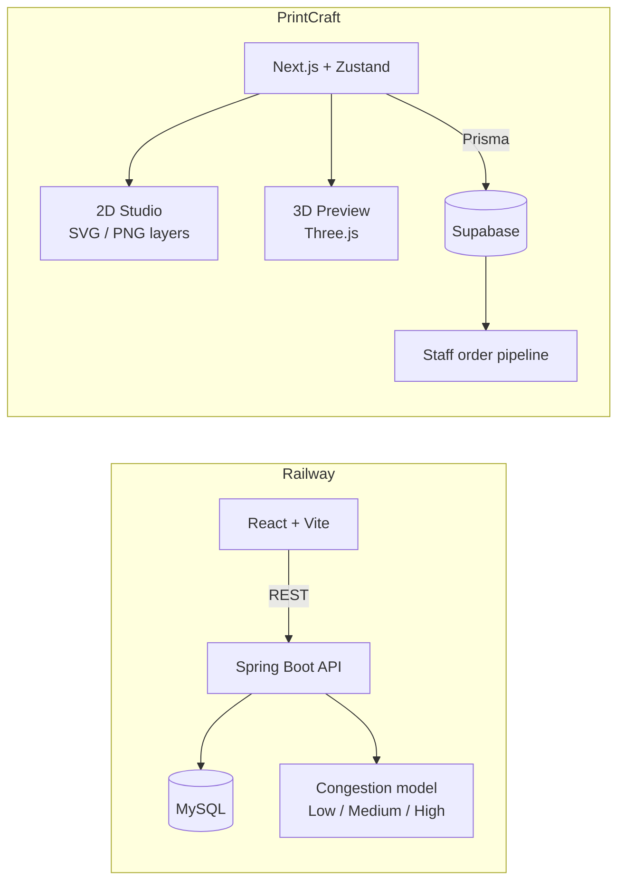

<div align="center">

# Ilmaan Khan

**I build full-stack apps end to end, from the database schema to the last pixel.**

<br/>


[LinkedIn](https://www.linkedin.com/in/ilmaan-khan/) · [Email](mailto:ilm2ankhan@gmail.com) · [GitHub](https://github.com/ilm2ankhan-maker)

</div>

---

## Demo

<!-- Replace with a real GIF or screenshot. Keep each under ~5 MB. -->
<div align="center">

| Railway Congestion Prediction | PrintCraft Design Studio |
|:---:|:---:|
|  |  |

</div>

---

## Why this exists

I'm a third-year-in-the-making Information Science student who learns fastest by shipping complete things. Tutorials teach syntax; building a real app teaches schema design, API contracts, state management, and what breaks when users show up.

**What I focus on**

- **Full-stack ownership.** I design the data model, write the API, and build the UI.
- **Real problems, real clients.** One project predicts station congestion from reservation data; another is in use-case development for a working print shop in Bengaluru.
- **Boring tech, done well.** Relational databases, typed code, REST APIs that do one thing clearly.
- **Complex interactions.** 2D editors, SVG processing, and a 3D preview in the browser.

---

## Projects

### [Railway Congestion Prediction System](https://github.com/ilm2ankhan-maker/Railway_congestion)

Look up a PNR and see whether the station will be Low, Medium, or High congestion.


- Congestion lookup by PNR number
- Three-level prediction (Low / Medium / High) from reservation data
- REST API between a React (Vite) frontend and Spring Boot backend
- MySQL for persistence

### [PrintCraft: Digital Prepress and E-Commerce](https://github.com/ilm2ankhan-maker/printcraft-vajra-prints)

A web platform for Vajra Prints, a commercial printing business in Bengaluru. Built as a team project at CMRIT.


- 2D design studio with bleed lines, templates, and SVG/PNG layer handling
- 3D packaging customizer with real-time design preview (Three.js)
- Laser-cutting price calculator driven by SVG outlines
- Staff dashboard with an order management pipeline

---

## Quick start

Run either project locally. Commands below are the standard ones for each stack; check each repo's README if something differs.

<details>
<summary><b>Railway Congestion Prediction System</b></summary>

**Prerequisites**

- Java 17+
- Maven
- Node.js 18+
- MySQL 8+

**Install**

```bash
git clone https://github.com/ilm2ankhan-maker/Railway_congestion.git
cd Railway_congestion
```

Create a MySQL database and set your credentials in the backend's `application.properties`:

```sql
CREATE DATABASE railway_congestion;
```

**Run**

```bash
# Backend (Spring Boot)
cd backend
mvn spring-boot:run

# Frontend (React + Vite), in a second terminal
cd frontend
npm install
npm run dev
```

Open the URL Vite prints (usually `http://localhost:5173`) and search by PNR.

</details>

<details>
<summary><b>PrintCraft</b></summary>

**Prerequisites**

- Node.js 18+
- A Supabase project (Postgres connection string and API keys)

**Install**

```bash
git clone https://github.com/ilm2ankhan-maker/printcraft-vajra-prints.git
cd printcraft-vajra-prints
npm install
```

Create `.env` with your own values:

```env
DATABASE_URL="postgresql://..."
NEXT_PUBLIC_SUPABASE_URL="https://<project>.supabase.co"
NEXT_PUBLIC_SUPABASE_ANON_KEY="..."
```

**Run**

```bash
npx prisma migrate dev
npm run dev
```

Open `http://localhost:3000`.

</details>

---

## How it works

Both projects follow the same shape: a typed client, a thin API layer, and a relational store.



---

## Roadmap

- [ ] Add screenshots and demo GIFs to both project READMEs
- [ ] Write tests for the Railway prediction logic
- [ ] Deploy both projects with live links
- [ ] Add CI (build and lint) via GitHub Actions
- [ ] Write up what I learned building the 3D packaging preview

---

## Contributing and collaboration

Found a bug or have an idea in either project? Open an issue or send a PR. Small, focused changes are easiest to review.

I'm also looking for a **Software Engineering internship** where I can work on production code and learn from people who've shipped a lot. If that sounds like your team, reach out.

<div align="center">

[LinkedIn](https://www.linkedin.com/in/ilmaan-khan/) · [ilm2ankhan@gmail.com](mailto:ilm2ankhan@gmail.com)

</div>
